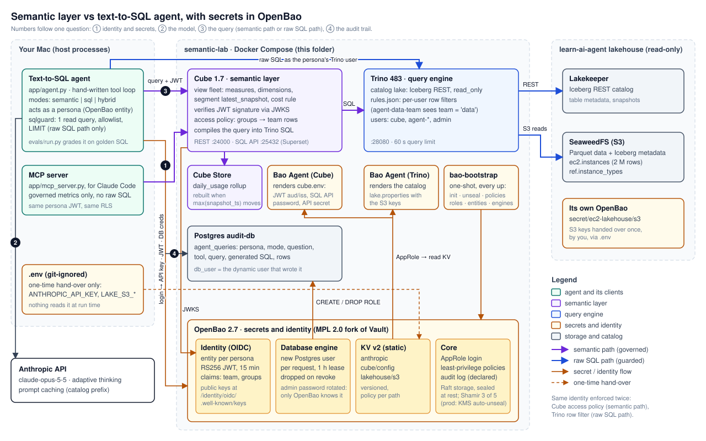

# Semantic layers and text-to-SQL for agents

A hands-on course: an AI agent that answers questions about an EC2 fleet by querying an
Iceberg lakehouse, built three ways (through a **semantic layer**, with **raw text-to-SQL**,
and a **hybrid** of both), measured against each other, with every secret in **OpenBao**.

It builds on the lakehouse from [learn-ai-agent](https://github.com/ankitkhare-joyent/learn-ai-agent) (Lakekeeper + SeaweedFS, table
`ec2.instances`: 2-hourly `describe-instances` snapshots, Apr-Sep 2026) and only reads it.

| Piece | Choice | Why |
|---|---|---|
| Semantic layer | **Cube Core 1.7** (Apache 2.0) | open-source server with REST/SQL/MCP APIs, access policies, pre-aggregations |
| Engine | **Trino 483** | reads Iceberg via the REST catalog; the engine I run in production |
| Secrets & identity | **OpenBao 2.7** (MPL 2.0, Linux Foundation) | the open-source fork of Vault after Vault moved to BSL |
| Agent | **Claude Opus 5.5**, hand-written tool loop | every step visible: no framework |
| Guardrails | sqlglot parse checks + Trino read-only catalog and row filters | defence in depth |



## Results

One run of the [eval harness](docs/07-evals.md) (Claude Opus 5.5, 11 hand-written questions, each with a trap: grain, semi-additive measures, a business rule, value grounding, security):

| Mode | Accuracy | Avg seconds | Avg tool calls | Avg output tokens |
|---|---|---|---|---|
| Semantic layer | 11/11 | 7.7 | 1.3 | 341 |
| Raw SQL | 10/11 | 12.5 | 2.5 | 858 |
| Hybrid | 11/11 | 6.0 | 1.4 | 382 |

## What I took away

Raw SQL did better than I expected and passed every grain trap. I'd give most of the credit to the lakehouse: one
flat table with documented columns. The model can only be as good as the schema it reads.

Its one miss was the cost question, because the price book only exists in the semantic layer. The agent said so
instead of inventing prices. That comes from one line in the system prompt, and I'd keep that line in any agent like
this.

Semantic mode used about half the tool calls and roughly 60% fewer output tokens than raw SQL, so hybrid (semantic
first, SQL as a fallback) is what I'd ship. The restricted-persona question was denied in every mode, by Cube's access
policy and by Trino's row filter, and it stays in the eval set so a broken guardrail shows up as a failing test.

Longer write-up: [How I evaluate a Text2SQL agent](https://ankitkhare.dev/writing/text2sql-evals/).

## Read in this order

1. [Semantic layers: what and why](docs/01-semantic-layers.md)
2. [How text-to-SQL agents work](docs/02-text-to-sql.md)
3. [Secrets with OpenBao (and why not Vault)](docs/03-openbao.md)
4. [Running the stack; one question end to end](docs/04-the-stack.md)
5. [The Cube data model, file by file](docs/05-cube-model.md)
6. [The agent, file by file](docs/06-the-agent.md)
7. [Measuring it: evals and results](docs/07-evals.md)
8. [From this lab to production](docs/08-production.md)
9. [Architecture diagram](docs/09-architecture.md)

## Quick start

1. **Tools:** Docker (about 3.5 GB free for this lab), [mise](https://mise.jdx.dev).
   `mise install && uv sync` installs Python 3.13 and the dependencies.
2. **Hand over two secrets, once.** Create `.env` (git-ignored) with:
   ```
   ANTHROPIC_API_KEY=...
   LAKE_S3_ACCESS_KEY=...     # the lakehouse's S3 keys, from its OpenBao:
   LAKE_S3_SECRET_KEY=...     #   bao kv get secret/ec2-lakehouse/s3 (in learn-ai-agent)
   ```
   Bootstrap copies them into this lab's OpenBao; nothing reads `.env` after that.
3. **Start:** `scripts/up.sh` (starts the lakehouse too if needed, waits until healthy).
4. **Ask:**
   ```bash
   uv run python -m app.ask "What did the ml team spend on EC2 in August?"
   uv run python -m app.ask --mode sql "same question"
   uv run python -m app.ask --persona agent-data "How many payments instances are running?"
   ```
5. **Measure:** `uv run python -m evals.run`
6. **Stop:** `scripts/down.sh` (keeps data; OpenBao comes back sealed and `up.sh` unseals it).

## Layout

```
compose.yaml            the lab: OpenBao (+bootstrap, Bao Agents), Trino, Cube, Cube Store, audit Postgres
stack/openbao/          server config, bootstrap script, policies, Bao Agent templates, JWT claim template
stack/trino/etc/        Trino config, read-only Iceberg catalog template, per-user row filters
stack/cube/             Cube config (cube.py) and the data model (cubes + the `fleet` view)
stack/postgres/         audit table and the roles OpenBao uses for dynamic credentials
app/                    the agent, its tools, guardrails, OpenBao client, MCP server
evals/                  golden questions with truth SQL, the runner, results
tests/                  unit tests (sqlguard)
docs/                   the lessons
```

Ports: OpenBao 28200, Trino 28080, Cube 24000 (REST) / 25432 (SQL API), audit Postgres 25433.

---

Part of a set of hands-on labs: [learn-ai-agent](https://github.com/ankitkhare-joyent/learn-ai-agent) · [semantic-txt-2-sql](https://github.com/ankitkhare-joyent/semantic-txt-2-sql) · [agent-evals-observ](https://github.com/ankitkhare-joyent/agent-evals-observ). More at [ankitkhare.dev](https://ankitkhare.dev).
