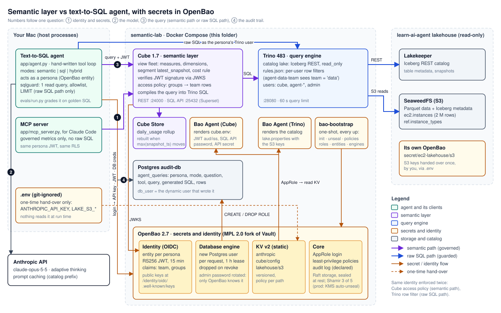

# 09 · Architecture

## Reading the diagram

**① Identity and secrets.** The agent (or the MCP server) logs in to OpenBao with its
persona's AppRole. With that 1-hour token it reads the Anthropic key from KV, mints a
15-minute RS256 identity JWT (claims: `persona`, `team`, `groups`), and, when it first
writes to the audit log, leases a brand-new Postgres user.

**② The model.** Every turn of the loop is a Messages API call to Claude Opus 5.5, with
the tools and the catalog as a cached prefix.

**③ The query, two ways.**
- *Semantic path (purple):* the agent sends a JSON query plus the JWT to Cube. Cube
  verifies the signature with OpenBao's public JWKS, turns `groups` into an access policy
  (team row filter), and either answers from the `daily_usage` rollup in Cube Store or
  compiles SQL and runs it on Trino as user `cube`.
- *Raw SQL path (blue):* the agent's SQL passes `sqlguard`, then runs on Trino as the
  persona's own user, where `rules.json` applies the same team row filter. Same identity,
  enforced by a different system.

Either way Trino reads table metadata from Lakekeeper (Iceberg REST) and Parquet files
from SeaweedFS, through a read-only catalog whose S3 keys a Bao Agent rendered from
OpenBao. Trino itself never sees an OpenBao token.

**④ The audit trail.** Each tool call is written to `agent_queries` with the generated
SQL, by a Postgres user OpenBao created minutes ago and drops when the agent exits.

**Secrets at rest (amber).** `bao-bootstrap` initialises, unseals and configures OpenBao on
every `up`. Bao Agent sidecars give Trino and Cube their secrets as files. The dashed line
is the only time a secret travels outside OpenBao: your one-time hand-over through `.env`.

## What to remember

1. **The semantic layer is where meaning lives.** Grain, valid aggregations, business
   rules and access live in the model, so every consumer (agent, MCP client, Superset)
   gets the same answer.
2. **Text-to-SQL is good and getting better, but it can only know what the data says.**
   Rules that exist nowhere in the tables (the price book) need a semantic layer.
3. **Hybrid, labelled.** Governed metrics first; raw SQL as an explicit, audited fallback.
4. **Identity, not shared credentials.** The agent acts as someone, and every system
   (Cube, Trino, Postgres, OpenBao) enforces what that someone may see.
5. **Short-lived everything.** 15-minute tokens, 1-hour database users, rotated admin
   passwords: a leak expires on its own.
6. **OpenBao is Vault's API under an open licence.** What you learn here carries over to
   Vault, and the reverse.
